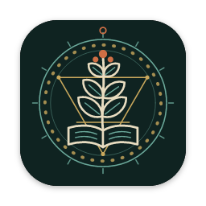

# Sprig

A self-hosted read-it-later app: a small Python server saves articles, X posts and RSS feeds, works out how long each takes to read and what it's about, and native iPhone and Mac apps open onto "what can I read in the time I have". Built as a personal replacement for Readwise Reader.

## What it does

- **Saving.** Share a link to Sprig from any iPhone app, or subscribe to RSS and Atom feeds. Saved links land in the Inbox; new feed posts land in the Feed, where each is kept (moved to the Inbox) or archived.
- **Reading time and topics.** Every item gets a reading time from its word count and one to three topics from your own short list, picked by Claude Haiku. The time range (Under 5, 5–15, 15–30, 30+) and the topic chips are the first thing on every list. Correct a topic and later picks follow the correction.
- **A clean reader.** Articles are extracted to plain HTML that keeps their formatting: bold and italics, numbered lists, inline and block code, tables and image captions. Page chrome, breadcrumbs and repeated headlines are dropped. PDFs open as the PDF itself.
- **X posts.** A post is saved with the same author's thread above it, as cards. An X Article is saved in full, with its images, videos, tables and embedded posts. A post that only points at a page is saved as that page, and a post with something to say about a link carries the linked page underneath.
- **Feeds without clutter.** Feeds are checked every 30 minutes, posts leave the Feed after 30 days, and posts that turn out to be teasers or can't be fetched stay out of the list.
- **Offline and in sync.** Each device keeps the whole library in its own SQLite database, syncs every minute and queues changes made offline. Archive, star, mark unread, edit topics, copy the link, search within a tab.
- **Native on each device.** iPhone: tabs, swipe actions, a share extension and an Up Next home-screen widget. Mac: a three-column reader driven from the keyboard (`j`/`k`, `e` archive, `s` star, `o` open original).
- **Moving in.** One command imports a Readwise Reader inbox and Later list, and another subscribes to every feed in an OPML file.

## How it works

```
 Share extension ─┐                       ┌─ worker: fetch → extract → time → tag
 iPhone app ──────┼─ HTTPS, bearer token ─▶ Sprig server (FastAPI) ──▶ SQLite
 Mac app ─────────┘   GET /api/changes    └─ feed poller (every 30 minutes)
   SprigCore: local GRDB store,
   sync engine, filters, search
```

- **Server** (`server/sprig/`): a FastAPI app on `127.0.0.1` with one token per device. A background worker takes each new link through `pipeline.py`: fetch the page, extract it (`extract.py`, on trafilatura), count the words, and tag it (`tagger.py`). Tagging uses the Anthropic API when `ANTHROPIC_API_KEY` is set and a signed-in Claude Code otherwise; without either, everything works except topics.
- **X posts** (`tweets.py`, `x_articles.py`): read through the keyless endpoint X's own embedded posts use, which returns a post and the one it replies to, so a thread is walked upward from its last post. X Article bodies come from FxTwitter and are converted from Draft.js blocks to reader HTML.
- **Sync.** Every change bumps a sequence number on the server; a device asks for everything after the last one it saw (`GET /api/changes?since=`), and sends its own edits as per-field patches with timestamps, so the latest edit of each field wins.
- **SprigCore** (`ios/SprigCore/`): a Swift package with everything that doesn't need a screen: models, API client, the local store, the sync engine, filters, search and the widget's picks. It is tested on its own with `swift test`.
- **Apps** (`ios/App`, `ios/Mac`): two SwiftUI apps over SprigCore that share the row, the filter bar and the article page. The reader is a `WKWebView` showing the server's HTML with one stylesheet (`reader.css`) for both.

## Tech stack

Server: Python 3.12+, uv, FastAPI and uvicorn, `sqlite3`, httpx, trafilatura, feedparser, pypdf, the Anthropic SDK, pytest. Apps: Swift 6, SwiftUI, WidgetKit, WebKit, GRDB 7, XcodeGen; iOS 18 and macOS 15. Hosting: launchd and Tailscale Serve on a Mac.

## Getting started

Requirements: [uv](https://docs.astral.sh/uv/), and for the apps Xcode with Swift 6 plus [XcodeGen](https://github.com/yonaskolb/XcodeGen).

### Run the server

```sh
cd server
uv sync
uv run sprig token add iphone    # prints a token; paste it into the app's Settings
uv run sprig serve               # http://127.0.0.1:8792; GET /health to check
```

| Variable | Meaning |
|---|---|
| `SPRIG_HOME` | Folder for `sprig.sqlite` and `tokens.json` (default `~/sprig-hub`) |
| `ANTHROPIC_API_KEY` | Tags items through the Anthropic API; without it a signed-in Claude Code is used |
| `CLAUDE_BIN` | Path to the `claude` binary, if it isn't where Sprig looks |
| `READWISE_TOKEN` | Only for `sprig import-reader` |

The server has no sign-up or accounts, only device tokens, and is meant for a private network. [docs/hub.md](docs/hub.md) covers running it under launchd, publishing it on a tailnet, and importing from Readwise Reader.

### Build the apps

```sh
cd ios
cp .env.example .env             # set DEVELOPMENT_TEAM to sign iPhone builds
scripts/generate-project.sh      # writes Sprig.xcodeproj from project.yml (not committed)
open Sprig.xcodeproj             # run the Sprig scheme (iPhone) or SprigMac
```

The bundle and app-group IDs in `ios/project.yml` are the author's; change them to your own to sign a build. In the app's Settings, enter the server's address and a token.

## Tests

```sh
cd server && uv run --group dev python -m pytest -q    # pytest: 107 tests in 15 files
cd ios/SprigCore && swift test                         # Swift Testing: 43 tests
```

The server tests cover the API and its tokens, the store and sync sequence, article extraction (formatting, captions, link cards, page chrome), X threads and X Articles against recorded responses, PDFs, feeds, the Reader import, URL canonicalization, reading time and both taggers. The Swift tests cover the models against the server's JSON, filters and time ranges, search, the sync engine, archive and undo, list selection and the widget's picks. No test touches the network.

## Project layout

```
server/
  sprig/        api, store, pipeline, extract, tweets, x_articles, feeds, tagger, cli
  tests/        pytest suite and recorded fixtures
  ops/          launchd job and its start script
ios/
  SprigCore/    Swift package: models, API client, local store, sync, search, widget picks
  App/          iPhone app: lists, reader, settings, and the reader stylesheet
  Mac/          Mac app: sidebar, list, reader, Story menu
  Share/        share extension
  Widget/       Up Next home-screen widget
  project.yml   XcodeGen spec; scripts/generate-project.sh turns it into the Xcode project
docs/hub.md     running the server on a Mac: launchd, Tailscale, imports
PRODUCT.md      who it's for and what it does
DESIGN.md       the visual system both apps follow
```

## License

See [LICENSE](LICENSE).
